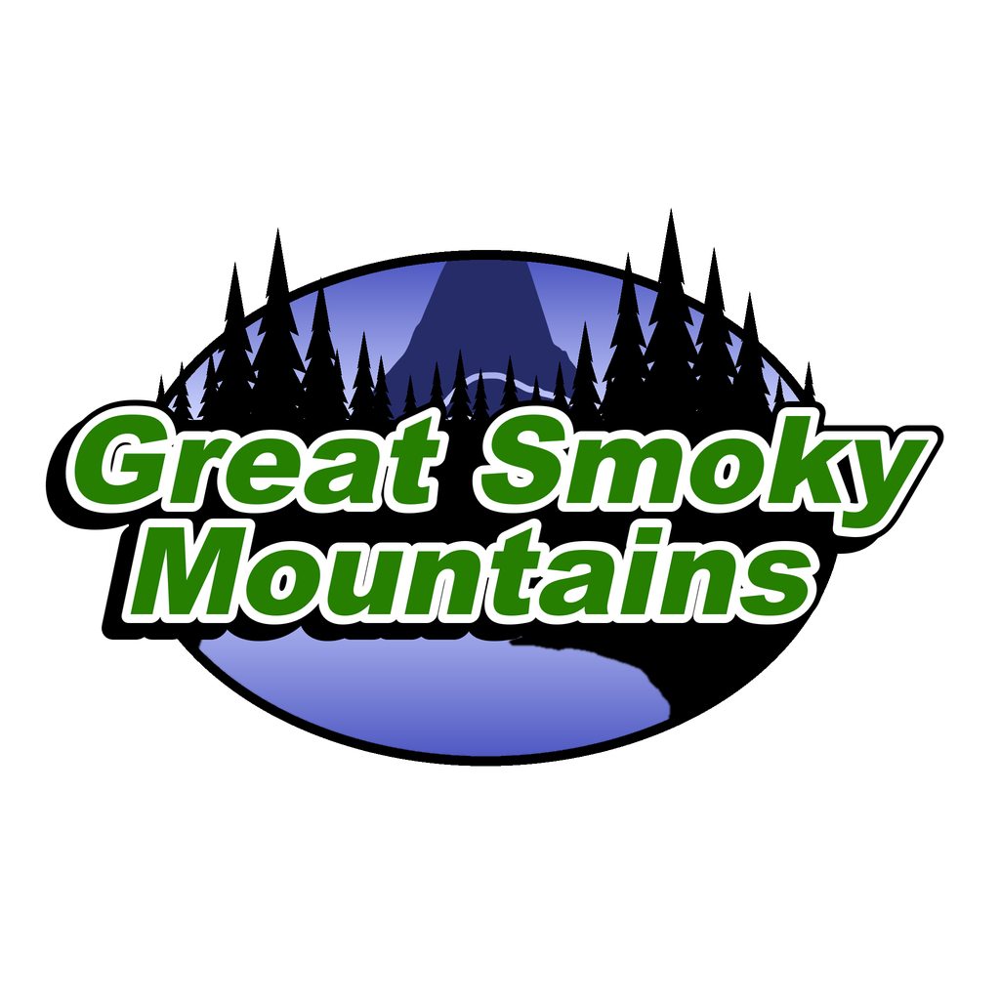
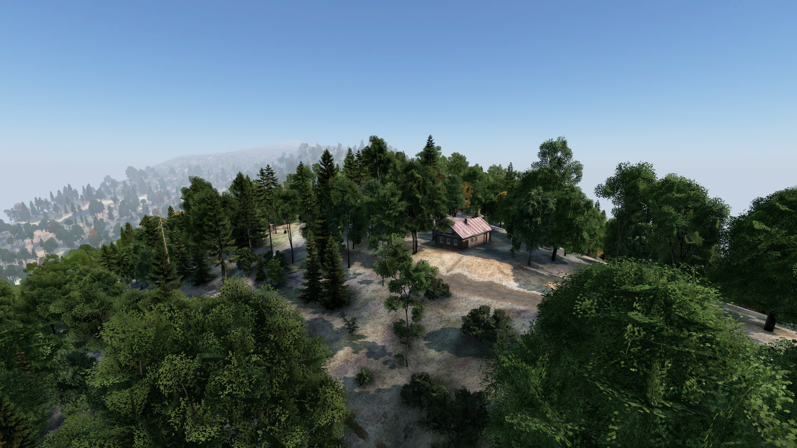
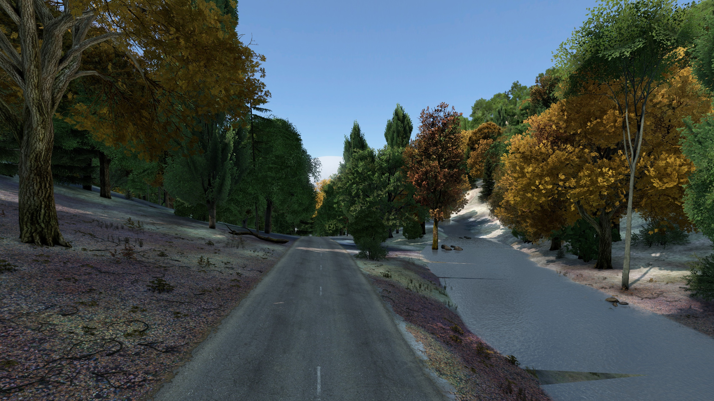
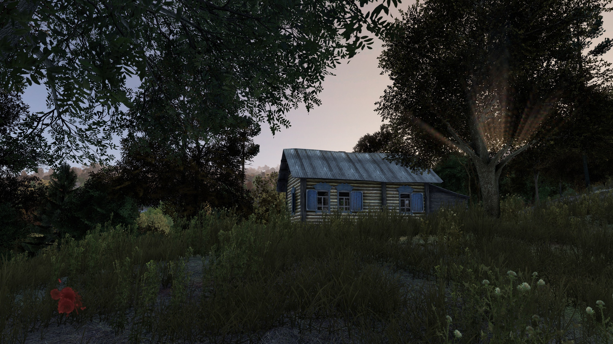

<h1 align="center">
   
  
   
  
   
</h1>

<h3 align="center">A Real-Scale Map of the Great Smoky Mountains for DayZ</h3>

  
  
  

  <a href="https://steamcommunity.com/sharedfiles/filedetails/?id=2812533524">Workshop</a> •
  <a href="#key-features">Key Features</a> •
  <a href="#installation">Installation</a> •
  <a href="#credits">Credits</a> •
  <a href="#license">License & Terms</a> •
  <a href='CHANGELOG.md'>Change Log</a>

## Information

Great Smoky Mountains is a 20 x 20 km DayZ map of the Smokies at real scale: Gatlinburg, Pittman Center, Mount Le Conte and Newfound Gap.
The ground is the real terrain, and the roads, hiking trails, creeks, buildings and place names come from OpenStreetMap, so the map is laid out like the real place.

  
  
  

## Requirements

* DayZ 1.30. No other mods are needed: load Great Smoky Mountains on both the server and every client.

## Key Features

* **Real terrain at real scale**: 20 x 20 km on a 5 m height grid, from 327 m in the valleys to 2,010 m on Mount Le Conte.
* **Towns and places**: Gatlinburg, Pittman Center, Cartertown, Glade, Pinnacle, Sugarlands, Twin Creeks and Zion Grove, with ranger stations, LeConte Lodge, campgrounds, RV resorts, backcountry campsites and trail shelters.
* **Gatlinburg as it is**: about 1,800 of its mapped buildings as vanilla models, more than 1,000 rental cabins along the residential streets, fuel stations, street lamps and mailboxes, the Gatlinburg SkyBridge, and the Ober Mountain Aerial Tramway, the Gatlinburg Sky Lift and two chair lifts.
* **Roads and hiking trails**: 560 km of roads and 264 km of trails, including 23 km of the Appalachian Trail, Alum Cave, Boulevard, Rainbow Falls and Trillium Gap. The trails have painted blazes, footbridges over the creeks, and National Park Service style signs at trailheads and junctions.
* **Water**: 45 km of rivers and about 720 km of streams and brooks laid along the valley floors, with waterfalls, ponds, creek boulders, springs and water pumps.
* **The forest**: more than 3 million trees in zones by elevation and slope, from cove hardwoods and oak-pine to the spruce-fir on the high peaks, with laurel thickets, dead and fallen firs, and a wildflower meadow on the open ground.
* **Cliffs and rock**: cliff faces, outcrops and boulders placed from the terrain's slopes and the mapped cliffs and peaks.
* **Overlooks, picnic areas and farms**: furniture at the overlooks, trailheads and picnic areas, and orchards at the old homesteads.
* **Ready to run**: a mission with the loot economy, player spawns and events, a paper map, and an intro scene.

## Installation

1. Subscribe to Great Smoky Mountains on the [Steam Workshop](https://steamcommunity.com/sharedfiles/filedetails/?id=2812533524).
2. Install the published `@greatsmokymountains` folder beside the DayZ server executable, and copy the included `.bikey` into the server's `keys` folder.
3. Copy `mission/dayzOffline.greatsmokymountains` from this repository into the server's `mpmissions` folder.
4. In `serverDZ.cfg`, set the mission template to `dayzOffline.greatsmokymountains`.
5. Add `-mod=@greatsmokymountains` to the server launch parameters. Every connecting player must load the same Workshop mod.

## The Geb's family

Every mod by Geb stands on its own, so a server can run the ones it wants:

* [Gebsfish](https://github.com/PackJC/gebsfish) ([wiki](https://packjc.github.io/gebsfish/)): the fishing overhaul, with 94 catchable species, rods, lures, coolers, the jon boat and more
* [Geb's Animals](https://github.com/PackJC/gebsanimals) ([website](https://packjc.github.io/gebsanimals/)): 15 wildlife species
* [Geb's Plants](https://github.com/PackJC/gebsplants) ([website](https://packjc.github.io/gebsplants/)): 27 garden crops and wild ginseng
* [Geb's Mushrooms](https://github.com/PackJC/gebsmushrooms) ([website](https://packjc.github.io/gebsmushrooms/)): 63 edible and poisonous fungi
* [Alien Invasion](https://github.com/PackJC/alieninvasion) ([website](https://packjc.github.io/alieninvasion/)): UFO crash sites, Little Green Men and the Montauk plasma rifle
* [Great Smoky Mountains](https://github.com/PackJC/greatsmokymountains) ([Workshop](https://steamcommunity.com/sharedfiles/filedetails/?id=2812533524)) (this mod): a 20 x 20 km map of the Smokies at real scale

## Credits

- Roads, trails, water, buildings, rock and place names from [OpenStreetMap](https://www.openstreetmap.org/copyright) © OpenStreetMap contributors, under the [Open Database License](https://opendatacommons.org/licenses/odbl/).
- Elevation from the [Terrain Tiles](https://registry.opendata.aws/terrain-tiles/) dataset on AWS (Mapzen), built from public elevation data including the USGS 3D Elevation Program.
- The DayZ Modding Community <3

## Support

If you like this project and think it has improved your server in any way, consider contributing! We are always looking for help with ideas, new models, and any monetary support that can help improve the map. Open a ticket in the [Discord](https://discord.gg/G8uSGZ8yyf) to discuss how you can contribute, or report a bug on [GitHub](https://github.com/PackJC/greatsmokymountains/issues).

## License

[Attribution-NonCommercial-NoDerivatives 4.0 International](https://github.com/PackJC/greatsmokymountains/blob/main/LICENSE)

The map data in `source/` that comes from OpenStreetMap (roads, trails, water, buildings, rock and places) stays under the [Open Database License](https://opendatacommons.org/licenses/odbl/), not the licence above.

## Usage & Terms
This item is NOT authorized (strictly forbidden) for any of these conditions:
- posting on Steam, except under the Steam account Cole.
- hosting on any download server other than Great Smoky Mountains current workshop download.
- hosting on any launcher for distribution other than Great Smoky Mountains current workshop download.
- to be packaged in any form other than Great Smoky Mountains current workshop download.
- to create derivative works.

## PERMISSION IS NOT GRANTED FOR THIS MOD TO BE INCLUDED IN A "SERVER PACK" or "MOD PACK" DO NOT EVEN ASK TO REPACK. NO. NOT ALLOWED.
Use a Collection if you want to include this mod on your server for your users.

## Monetization
You are hereby given monetization approval under the conditions that you follow the DayZ Server Monetization agreement and have obtained permission from Bohemia. Read more here https://www.bohemia.net/monetization

## Donations
We accept donations at https://www.paypal.com/paypalme/packjc every dollar counts and we greatly appreciate any contributions!

### Copyright © Smoky Mountain Software 2022-2026
